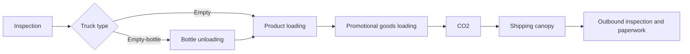

<div align="center">

# Truck Dispatch Simulator

**Explore how dispatch order and intervals affect truck turnaround time.**


[English](#english) · [한국어](#한국어) · [Validation evidence](docs/VALIDATION.md) · [Original requirements](트럭의%20배차%20순서를%20입력하면%20트럭별%20소요시간을%20계산해주는%20파이썬.txt)

</div>

---

## English

### About

A Python/Tkinter desktop prototype for modeling the movement of **empty-bottle trucks** (`병`) and **empty trucks** (`공`) through inspection, unloading, loading, and outbound operations. Enter a dispatch sequence, a fixed interval, and a first departure time to generate truck-level schedules and turnaround statistics.

The project makes operational assumptions inspectable: stage durations are explicit, shared resources are represented in code, and loading groups show which trucks are scheduled together. The repository preserves four source iterations, the original Korean requirements, two Excel reference workbooks, and an existing Windows executable.

> **Model status:** the original scheduling algorithm has reproducible resource conflicts, including in the supplied 12-truck example. Treat outputs as prototype calculations, not validated operational schedules. See [Validation](#validation) before interpreting results.

### Highlights

| Capability | What the project provides |
| :--- | :--- |
| Scenario inputs | Truck sequence, dispatch interval in minutes, first start time |
| Two truck routes | Separate fixed durations for empty-bottle and empty trucks |
| Resource representation | Four intended exclusive stations and a product-loading station intended for four trucks |
| Schedule visibility | Stage arrival, actual start, and end timestamps for each truck |
| Loading groups | Time intervals and truck memberships during product loading |
| Turnaround summaries | Per-truck duration and overall / truck-type arithmetic means |
| Traceable materials | Original requirements, source iterations, Excel references, and packaging specification |

### Process model



The diagram omits transfer stages for readability. All values below are **minutes**, taken from `process_times` in the latest source.

| Stage | Empty-bottle (`병`) | Empty (`공`) | Intended concurrent capacity |
| :--- | ---: | ---: | :--- |
| Inspection / bottle-unloading queue | 5 | 5 | 1 |
| Transfer 1 | 2 | 0 | Unconstrained |
| Bottle unloading | 8 | 0 (skipped) | 1 |
| Transfer 2 | 3 | 2 | Unconstrained |
| Product loading | 15 | 17 | 4 |
| Transfer 3 | 3 | 4 | Unconstrained |
| Promotional goods loading | 5 | 5 | 1 |
| Transfer 4 | 2 | 1 | Unconstrained |
| CO2 | 5 | 4 | 1 |
| Shipping canopy | 2 | 3 | Unconstrained |
| Outbound inspection and paperwork | 5 | 3 | Unconstrained |
| **Total without waiting** | **55** | **44** | — |

These capacities describe the intended model; the current implementation does not reliably enforce all of them.

### Quick start

Use Python 3 with Tkinter installed. The latest source uses only the Python standard library; no runtime `pip install` is required. The diagnostic script was run with **Python 3.13.5**; other versions have not been verified here.

```bash
git clone https://github.com/fortranmentis/truck-dispatch-simulator.git
cd truck-dispatch-simulator
python "공병공차계산4.py"
```

If Tkinter is unavailable, install the Tk support provided by your Python distribution or operating system. A desktop display is required for the GUI. The interface and original source comments are in Korean.

Enter the following example, then click **실행** (Run):

| Field | Example |
| :--- | :--- |
| Dispatch sequence | `병1 병2 병3 병4 병5 병6 병7 공1 공2 공3 공4 병8` |
| Dispatch interval | `5` |
| First start time | `09:00` |

The corresponding dispatch times run from 09:00 to 09:55. The output area displays stage schedules, simultaneous loading groups, and turnaround summaries. The current GUI does not load the reference workbooks or export results to Excel.

### Metric definitions

| Metric | Definition and interpretation |
| :--- | :--- |
| Scheduled dispatch | First start time + zero-based truck position × interval |
| Turnaround time | Final stage end − that truck's scheduled dispatch |
| Stage waiting time | Actual stage start − stage arrival; derivable from displayed timestamps |
| Overall mean turnaround | Sum of all truck turnaround times ÷ truck count |
| Truck-type mean | Same calculation restricted to one truck type |
| Loading occupancy | Number of active product-loading intervals at a timestamp |

Use half-open intervals `[start, end)` when checking occupancy: an ending operation releases capacity before another begins at that timestamp. The GUI currently displays zero for an absent truck-type mean; analytically, interpret this as **no observations**, not a measured zero-minute turnaround.

### Validation

Reproduce the source checks and known issues without opening the GUI:

```bash
python scripts/validate.py
```

| Check | Observed result |
| :--- | :--- |
| Parse all four original Python files | Passed |
| Single empty-bottle truck | 55 minutes |
| Single empty truck | 44 minutes |
| Stage chronology, supplied 12-truck example | Passed |
| Example mean turnaround | 59.33 minutes — computed from a schedule with conflicts |
| Example product-loading occupancy | **5 trucks; exceeds intended capacity of 4** |
| Example exclusive-station overlap pairs | **3 at promotional goods loading; 3 at CO2** |
| Future reservation conflict | Reproduced |
| Same-time empty-truck priority | Not applied in the reproduced case |

The script is a **diagnostic reproducer**. Successful completion means its baseline assertions and limitation reproductions ran; it does **not** certify resource feasibility. See [detailed evidence and scope](docs/VALIDATION.md). GUI interaction, binary execution, and comparison with observed site operations were not validated in this preparation.

### Repository guide

| Path | Role |
| :--- | :--- |
| `공병공차계산4.py` | Latest numbered source; Tkinter application entry point |
| `공병, 공차 계산.py` | Initial source iteration |
| `공병, 공차 계산2.py` | Intermediate source iteration |
| `공병, 공차 계산3.py` | Intermediate source iteration |
| `공차,공병차by뚠.xlsx`, `통합 문서4.xlsx` | Original Excel reference files; not runtime inputs |
| `트럭의 배차 순서를 입력하면 트럭별 소요시간을 계산해주는 파이썬.txt` | Original scenario and requirements |
| `공병공차계산4.spec`, `images.ico` | PyInstaller build specification and icon |
| `dist/OB_TRUCK_SIM.exe` | Existing Windows binary, preserved without rebuilding or executing |
| `scripts/validate.py` | Reproducible source diagnostics |
| `docs/VALIDATION.md` | Validation method, evidence, and limits |

Temporary `build/` contents, the duplicate distribution directory, and its ZIP are ignored. Original filenames are retained to preserve correspondence with the supplied materials.

### Notes

- **Scheduling limitations:** trucks are scheduled one complete route at a time. Conflict checks ignore some future reservations, allowing exclusive-resource overlaps and product-loading capacity violations. The same-time priority block executes after its overlap list has been emptied, so it does not implement the intended empty-truck preference.
- **Fixed assumptions:** durations are hardcoded. There is no fitted service-time distribution, stochastic variability, shift calendar, breakdown model, or optimization objective. Results are conditional on the entered scenario and these assumptions.
- **Input handling:** identifiers containing `병` are classified as empty-bottle trucks; all other identifiers become empty trucks. Use unique labels and nonnegative integer intervals. Negative intervals and malformed identifiers are not comprehensively rejected.
- **Time display:** calculations use datetimes, but the GUI prints only clock time. A scenario crossing midnight does not show the date change. Loading-group output can include zero-length rows at tied events; truck order inside a group is not guaranteed.
- **Data lineage:** Excel files are retained as reference artifacts. Their contents have not been audited, calibrated against the model, or used as validation ground truth.
- **Packaging:** to attempt a fresh Windows build, install PyInstaller in a separate environment and run `python -m PyInstaller "공병공차계산4.spec"`. The spec names its output `공병공차계산4`; correspondence with the preserved `OB_TRUCK_SIM.exe` has not been established. Packaging was not rerun.
- **Next validation priorities:** enforce full-interval resource capacity, implement explicit tie-breaking, reject invalid inputs, and reconcile feasible schedules against observed timestamps before operational use.
- **License:** no license was supplied with the original materials; this upload does not assign one.

---

## 한국어

### About · 프로젝트 소개

**공병트럭(`병`)과 공차트럭(`공`)의 공장 내 작업 일정과 소요시간을 계산하는 Python/Tkinter 데스크톱 프로토타입**입니다. 배차 순서, 일정한 배차 간격, 첫차 시작 시간을 입력하면 검수부터 출고검사까지 트럭별 일정을 생성합니다.

작업별 시간을 명시하고 공유 자원을 코드로 표현해, 배차 조건에 따른 일정과 제품상차 동시 작업 구성을 살펴볼 수 있습니다. 원본 코드 4개 버전, 최초 요구사항, 엑셀 참고자료 2개, 기존 Windows 실행파일을 보존했습니다.

> **모델 상태:** 원본 스케줄링 알고리즘은 최초 요구사항의 12대 예시에서도 자원 충돌이 재현됩니다. 계산 결과는 프로토타입 출력이며, 운영에 사용할 수 있다고 검증된 배차 계획이 아닙니다.

### Highlights · 주요 기능

| 기능 | 내용 |
| :--- | :--- |
| 시나리오 입력 | 배차 순서, 분 단위 배차 간격, 첫차 시작 시간 |
| 차종별 공정 | 공병트럭·공차트럭의 고정 작업시간 구분 |
| 공유 자원 표현 | 단독 작업장 4개 및 최대 4대를 의도한 제품상차 자원 |
| 트럭별 일정 | 각 작업의 도착·실제 시작·종료 시각 |
| 상차 그룹 | 제품상차 중 함께 작업하는 트럭과 시간 구간 |
| 소요시간 통계 | 트럭별 소요시간, 전체 및 차종별 산술평균 |
| 원본 추적 | 요구사항, 단계별 소스, 엑셀 자료, 패키징 설정 보존 |

### 공정 및 가정

검수 → 공병하차(공병트럭만) → 제품상차 → 선전품상차 → CO2 → 출하캐노피 → 출고검사 및 전표 순서로 진행하며, 작업 사이에 이동시간이 있습니다.

| 공정 | 공병트럭(분) | 공차트럭(분) | 의도된 동시 처리 대수 |
| :--- | ---: | ---: | :--- |
| 검수(공병하차대기) | 5 | 5 | 1 |
| 이동1 | 2 | 0 | 제한 없음 |
| 공병하차 | 8 | 0(생략) | 1 |
| 이동2 | 3 | 2 | 제한 없음 |
| 제품상차 | 15 | 17 | 4 |
| 이동3 | 3 | 4 | 제한 없음 |
| 선전품상차 | 5 | 5 | 1 |
| 이동4 | 2 | 1 | 제한 없음 |
| CO2 | 5 | 4 | 1 |
| 출하캐노피 | 2 | 3 | 제한 없음 |
| 출고검사 및 전표 | 5 | 3 | 제한 없음 |
| **대기 없는 총 소요시간** | **55** | **44** | — |

처리 대수는 설계상 제약입니다. 현재 구현은 모든 시나리오에서 이를 보장하지 않습니다.

### 실행 방법

Tkinter가 포함된 Python 3와 데스크톱 화면 환경이 필요합니다. 최신 소스는 표준 라이브러리만 사용하므로 실행을 위한 별도 `pip install`은 필요하지 않습니다. 이번 진단에 사용한 환경은 **Python 3.13.5**입니다.

```bash
git clone https://github.com/fortranmentis/truck-dispatch-simulator.git
cd truck-dispatch-simulator
python "공병공차계산4.py"
```

Tkinter가 없다면 Python 배포판 또는 운영체제에서 제공하는 Tk 지원을 설치하세요. GUI와 원본 주석은 한국어입니다.

| 입력 항목 | 예시 |
| :--- | :--- |
| 배차 순서 | `병1 병2 병3 병4 병5 병6 병7 공1 공2 공3 공4 병8` |
| 배차 간격 | `5` |
| 첫차 시작 시간 | `09:00` |

**실행** 버튼을 누르면 작업 일정, 제품상차 그룹, 소요시간 통계가 표시됩니다. 예시의 배차 시각은 09:00부터 09:55까지입니다. 현재 GUI에는 엑셀 자료 불러오기나 결과 엑셀 내보내기 기능이 없습니다.

### 지표 정의

| 지표 | 정의 및 해석 |
| :--- | :--- |
| 예정 배차 시각 | 첫차 시작 시간 + 0부터 센 배차 순번 × 배차 간격 |
| 트럭 소요시간 | 마지막 작업 종료 시각 − 해당 트럭의 예정 배차 시각 |
| 공정 대기시간 | 실제 작업 시작 − 작업장 도착; 표시 시각으로 계산 가능 |
| 전체 평균 소요시간 | 모든 트럭 소요시간 합계 ÷ 전체 대수 |
| 차종별 평균 | 해당 차종만 대상으로 계산한 산술평균 |
| 제품상차 점유 대수 | 특정 시각에 제품상차 중인 트럭 수 |

점유 대수 검증은 `[시작, 종료)` 구간을 사용합니다. 같은 시각이라면 작업 종료가 먼저 자원을 반환합니다. 특정 차종이 없을 때 GUI에 표시되는 평균 0은 실제 0분이 아니라 **관측 대상 없음**으로 해석해야 합니다.

### Validation · 검증 결과

GUI를 열지 않고 원본 동작과 알려진 한계를 재현할 수 있습니다.

```bash
python scripts/validate.py
```

| 검증 항목 | 확인 결과 |
| :--- | :--- |
| 원본 Python 소스 4개 구문 분석 | 통과 |
| 공병트럭 1대 | 55분 |
| 공차트럭 1대 | 44분 |
| 12대 예시의 작업 시각 선후관계 | 통과 |
| 예시 전체 평균 소요시간 | 59.33분 — 자원 충돌이 있는 일정의 계산값 |
| 예시 제품상차 최대 점유 | **5대: 설계상 최대 4대 초과** |
| 예시 단독 작업장 중복 쌍 | **선전품상차 3쌍, CO2 3쌍** |
| 미래 예약과의 자원 충돌 | 재현됨 |
| 동시 도착 시 공차 우선 | 재현 사례에서 적용되지 않음 |

이 스크립트는 **진단 및 문제 재현용**입니다. 정상 종료는 기준값과 알려진 문제의 재현을 확인했다는 뜻이며, 일정의 자원 제약 충족을 인증하지 않습니다. 상세 방법은 [검증 문서](docs/VALIDATION.md)를 참고하세요. GUI 직접 조작, 기존 실행파일 실행, 실제 현장 기록과의 비교는 이번 준비 과정에서 검증하지 않았습니다.

### 자료 구성

| 파일 | 역할 |
| :--- | :--- |
| `공병공차계산4.py` | 최신 번호의 Tkinter 실행 소스 |
| `공병, 공차 계산.py`, `공병, 공차 계산2.py`, `공병, 공차 계산3.py` | 초기 및 중간 버전 |
| `공차,공병차by뚠.xlsx`, `통합 문서4.xlsx` | 원본 엑셀 참고자료; 실행 시 읽지 않음 |
| `트럭의 배차 순서를 입력하면 트럭별 소요시간을 계산해주는 파이썬.txt` | 최초 요구사항 |
| `공병공차계산4.spec`, `images.ico` | PyInstaller 설정과 아이콘 |
| `dist/OB_TRUCK_SIM.exe` | 재빌드·실행하지 않고 보존한 기존 Windows 실행파일 |
| `scripts/validate.py`, `docs/VALIDATION.md` | 재현 가능한 진단과 검증 기록 |

임시 `build/` 폴더, 중복 배포 폴더 및 ZIP은 제외했습니다. 자료 간 대응 관계를 유지하도록 원본 파일명은 보존했습니다.

### Notes · 해석 시 유의사항

- **스케줄링 한계:** 트럭 한 대의 전체 경로를 차례로 예약합니다. 충돌 검사에서 일부 미래 예약을 놓쳐 단독 자원 중복과 제품상차 용량 초과가 발생할 수 있습니다. 동시 도착 우선순위 코드는 중복 목록이 비워진 뒤 실행돼 공차 우선을 구현하지 못합니다.
- **고정 가정:** 공정 시간은 코드에 고정돼 있습니다. 확률분포 추정, 작업시간 변동, 교대·휴게시간, 설비 고장, 최적화 목적함수는 반영하지 않습니다.
- **입력값:** 이름에 `병`이 포함되면 공병트럭, 나머지는 모두 공차트럭으로 분류합니다. 고유한 이름과 0 이상의 정수 배차 간격을 사용하세요. 음수 간격과 잘못된 식별자를 충분히 검증하지 않습니다.
- **시간 표시:** 내부 날짜 계산과 달리 화면에는 시각만 표시해 자정을 넘는 일정의 날짜 변경을 보여주지 않습니다. 동시 이벤트에서 길이가 0인 상차 그룹이 출력될 수 있고, 그룹 내 트럭 표시 순서는 일정하지 않습니다.
- **데이터 출처:** 엑셀은 참고자료로 보존했으며 내용 감사, 모델 보정, 현장 정답 데이터로서의 검증은 수행하지 않았습니다.
- **배포:** 새 Windows 빌드를 시도하려면 별도 환경에 PyInstaller를 설치하고 `python -m PyInstaller "공병공차계산4.spec"`를 실행하세요. 설정상 출력명은 `공병공차계산4`이며 기존 `OB_TRUCK_SIM.exe`와의 소스 일치 여부는 확인하지 않았습니다. 이번에 재빌드는 수행하지 않았습니다.
- **후속 검증:** 전체 작업 구간의 자원 제약 보장, 명확한 동률 우선순위, 입력 검증을 개선한 뒤 실행 가능한 일정과 현장 관측 시각을 비교해야 합니다.
- **라이선스:** 원본에 라이선스가 제공되지 않아 이번 업로드에서는 별도로 지정하지 않았습니다.
